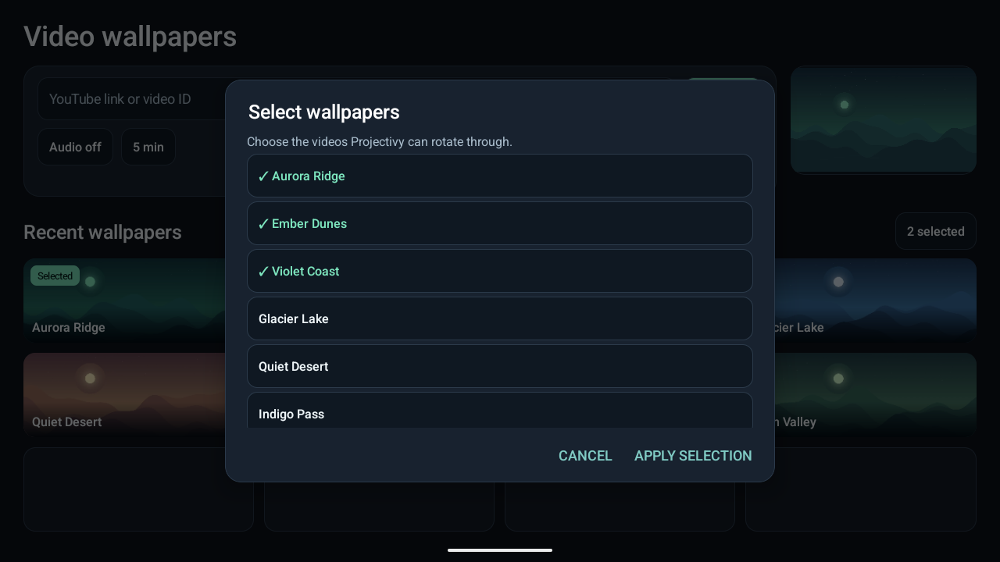
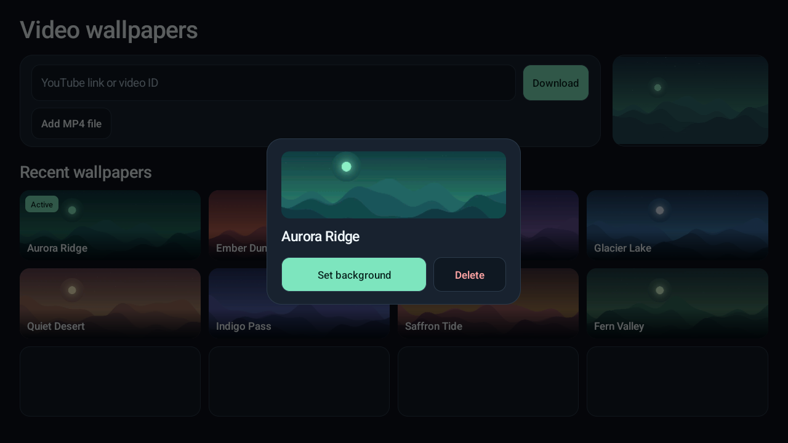
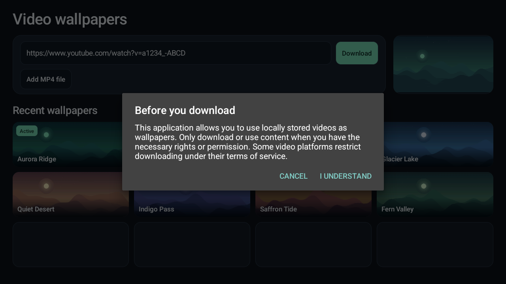
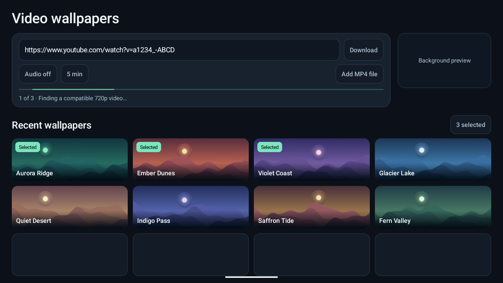

# Video Wallpaper for Projectivy Launcher


Play videos from your Android TV’s local storage as wallpapers in Projectivy Launcher. Save a short clip from a YouTube link you are permitted to download.

> This is an independently developed, unofficial plugin for Projectivy Launcher. It is not affiliated with or endorsed by the Projectivy Launcher developers, Google, or YouTube.

## Releases

GitHub releases include the source code for each version. The latest release also includes a signed APK for Android TV and Google TV.

- [Download the signed v0.7 APK](https://github.com/VideoWallpaperPL/projectivy-video-wallpaper/releases/download/v0.7/video-wallpaper-v0.7.apk)
- [v0.7 SHA-256 checksum](https://github.com/VideoWallpaperPL/projectivy-video-wallpaper/releases/download/v0.7/SHA256SUMS.txt)
- [Latest release notes](https://github.com/VideoWallpaperPL/projectivy-video-wallpaper/releases/latest)
- [All releases](https://github.com/VideoWallpaperPL/projectivy-video-wallpaper/releases)

Follow the [Android TV installation instructions](#install-on-android-tv) after downloading the APK.

## Screenshots




<details>
<summary>Wallpaper actions, download notice, and progress</summary>







</details>

These v0.7 screenshots use original sample artwork.

## Features

- **Simple and Advanced clips.** In **Simple**, add a YouTube link or video ID and use **Download** to save the first one to five minutes. The default is two minutes. Switch to **Advanced** to open the editor when you add a link. Play the preview, set start and end with the two handles or timestamps, then download up to five minutes. With the timeline focused, use the remote’s left and right buttons to adjust a handle and OK to switch handles. The app shows and previews any adjustment to the start before saving.
- **Download quality.** 720p is the default. The v0.8 build also offers 1080p when a compatible H.264 stream is available. It offers to switch to 720p if needed. Video and optional AAC audio are copied into the MP4 at source quality. The app prefers streams up to 30 fps when available.
- **Download progress.** Follow source lookup, copying, and saving, with an option to cancel. Clip size depends on available device storage. The app selects and previews each finished clip. If multiple wallpapers are selected, the new clip joins them.
- **Wallpaper library.** Browse the 12 newest clips in a six-by-two grid on TV. Select a thumbnail to set it as the background, save an MP4 copy to Downloads, or delete the app’s saved copy. On Android 7 through 9, use the system file picker to choose where to save the copy.
- **Multiple wallpapers.** Open **Select wallpapers**, check the clips you want in the thumbnail grid, and choose **Apply selection**. Projectivy receives the individual videos and controls when it switches between them.
- **Local storage.** Clips and the library stay on the device. YouTube requests go from the TV to YouTube and its media hosts. The app uses no developer backend, analytics, or account credentials.

## Install on Android TV

You need Android TV or Google TV running Android 7.0 or newer, plus Projectivy Launcher with Premium enabled for external wallpaper providers. [Projectivy plugin guide](https://projectivylauncher.com/plugins.html), [Projectivy’s Overflight listing](https://play.google.com/store/apps/details?id=tv.projectivy.plugin.wallpaperprovider.overflight)

Download the signed APK from [Releases](#releases), then sideload it with Android Debug Bridge.

1. Install [Android SDK Platform-Tools](https://developer.android.com/tools/releases/platform-tools) on your computer.
2. Enable debugging on the TV and connect using the options shown by the device. Approve the computer’s debugging prompt on the TV.
3. Confirm that `adb devices` lists the TV, then install the downloaded APK. Use `-s <device-serial>` when more than one device is connected.

```sh
adb devices
adb install -r video-wallpaper-v0.7.apk
```

Android requires the same signing key for an in-place update. If you installed a debug build, back up any clips you want to keep before removing it to install the signed release. [Android app signing](https://developer.android.com/studio/publish/app-signing)

Open **Video Wallpaper for Projectivy Launcher** on the same TV as Projectivy, add a clip, then choose the provider in **Projectivy Settings → Appearance → Wallpaper → Launcher wallpaper**. Set the video wallpaper volume in Projectivy to hear the clip. Clips live in the app's private library on the device where they were saved. [Projectivy release notes](https://github.com/spocky/miproja1/releases/tag/4.60)

## Downloads and content rights

Downloads from YouTube start only when you choose **Download**. A link shared to the app fills in the input field. The app supports public and unlisted prerecorded videos when compatible streams are available. Sign-in, access restrictions, and unavailable formats can prevent a download.

See [Disclaimer](DISCLAIMER.md) for content rights, platform terms, and hosting policies.

## Build and test

Build on macOS or Linux with JDK 17, Python 3.11, Bash, Make, a host C compiler, Android SDK Platform 35, Build Tools 35.0.0, and Android NDK 30.0.16248370. Configure the SDK through Android Studio, `ANDROID_HOME`, or a local `local.properties` file. To use a standalone installation of that NDK, set `PROJECTIVY_ANDROID_NDK` to its directory.

```sh
./gradlew :app:testDebugUnitTest :app:lintDebug :app:assembleDebug
```

The debug APK is written to `app/build/outputs/apk/debug/app-debug.apk`. The tests cover YouTube link parsing and wallpaper history, including capacity, replacement, selection, and deletion. [GitHub Actions](.github/workflows/android.yml) runs the tests and lint and assembles an unsigned release APK. The Gradle distribution, yt-dlp zipapp, and QuickJS source archive have pinned checksums.

## License

Original code and artwork are licensed under [GPL-3.0-only](LICENSE). The vendored Projectivy provider API remains under [Apache-2.0](licenses/projectivy-api.txt). Dependency licenses and attribution are listed in [Third-party licenses](THIRD_PARTY_LICENSES.md).
