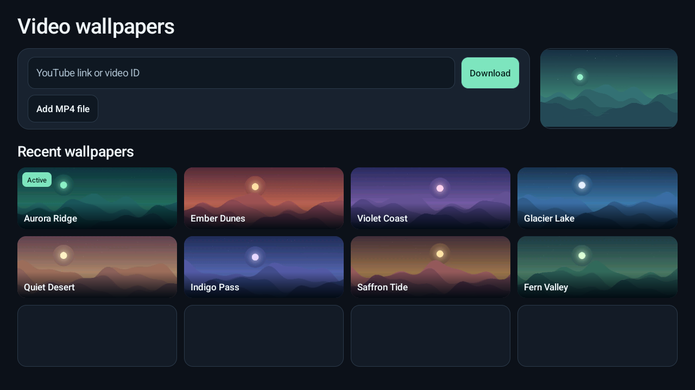

# Video Wallpaper for Projectivy Launcher


Play videos from your Android TV’s local storage as wallpapers in Projectivy Launcher. Import a compatible MP4, or request a short clip from a YouTube link you are permitted to download.

> This is an independently developed, unofficial plugin for Projectivy Launcher. It is not affiliated with or endorsed by the Projectivy Launcher developers, Google, or YouTube.

## Screenshots



<details>
<summary>Wallpaper actions and first-use notice</summary>


</details>

The screenshots use original illustrative graphics created for this project.

## Features

- **Local import.** Add a 720p or 1080p H.264 MP4. The app keeps its audio when present.
- **On-device downloads.** Paste or share a YouTube link or video ID, then choose **Download** and acknowledge the first-use notice. The app copies compatible 720p H.264 video and AAC audio into an MP4 without re-encoding either track. It prefers 30 fps when available.
- **Short wallpaper clips.** Preparation keeps the first two minutes, up to 64 MiB. The finished clip becomes active and starts previewing.
- **Wallpaper library.** Browse the 12 newest clips with your TV remote. Select a thumbnail to set it as the background or delete it.
- **Local storage.** Clips and the library stay on the device. YouTube requests go from the TV to YouTube and its media hosts. The app uses no developer backend, analytics, or account credentials.

## Install on Android TV

You need Android TV or Google TV running Android 7.0 or newer, plus Projectivy Launcher with Premium enabled for external wallpaper providers. [Projectivy plugin guide](https://projectivylauncher.com/plugins.html), [Projectivy’s Overflight listing](https://play.google.com/store/apps/details?id=tv.projectivy.plugin.wallpaperprovider.overflight)

Build a debug APK from this source, or use a signed APK when one is available from this repository’s GitHub Releases. This project uses manual sideloading.

1. Install [Android SDK Platform-Tools](https://developer.android.com/tools/releases/platform-tools) on your computer.
2. Enable debugging on the TV and connect using the options shown by the device. Approve the computer’s debugging prompt on the TV.
3. Confirm that `adb devices` lists the TV, then install the APK. Use `-s <device-serial>` when more than one device is connected.

```sh
adb devices
adb install -r app/build/outputs/apk/debug/app-debug.apk
```

Open **Video Wallpaper for Projectivy Launcher**, add a clip, then choose the provider in **Projectivy Settings → Appearance → Wallpaper → Launcher wallpaper**. Set the video wallpaper volume in Projectivy to hear the clip. [Projectivy release notes](https://github.com/spocky/miproja1/releases/tag/4.60)

## Downloads and content rights

Downloads start only when you choose **Download**. A link shared to the app fills in the input field. The app supports public and unlisted prerecorded videos when compatible streams are available. Sign-in, access restrictions, and unavailable formats can prevent a download. If YouTube declines a media request or the video is unsupported, use a compatible local MP4 you have permission to use.

See [Disclaimer](DISCLAIMER.md) for content rights, platform terms, and hosting policies.

## Build and test

Use JDK 17, Android SDK Platform 35, and Build Tools 35.0.0. Configure the SDK through Android Studio, `ANDROID_HOME`, or a local `local.properties` file.

```sh
./gradlew :app:testDebugUnitTest :app:lintDebug :app:assembleDebug
```

The tests cover YouTube link parsing and wallpaper history, including capacity, replacement, selection, and deletion. [GitHub Actions](.github/workflows/android.yml) runs the tests and lint and assembles an unsigned release APK. The Gradle distribution and yt-dlp zipapp have pinned checksums. Debug APK signatures depend on the build machine’s debug key.

## License and publication

Original code and artwork are licensed under [GPL-3.0-only](LICENSE). The vendored Projectivy provider API remains under [Apache-2.0](licenses/projectivy-api.txt). See [Third-party licenses](THIRD_PARTY_LICENSES.md) for the dependency inventory, retained notices, and the outstanding native-runtime source and attribution checks.

Start with a source-only GitHub repository named `projectivy-video-wallpaper`. Before attaching a signed APK to a release, complete the binary redistribution checks in [Third-party licenses](THIRD_PARTY_LICENSES.md) and keep the release signing key private. Release attachments are limited to the application APK and related documentation. [Android app-signing guide](https://developer.android.com/studio/publish/app-signing)
